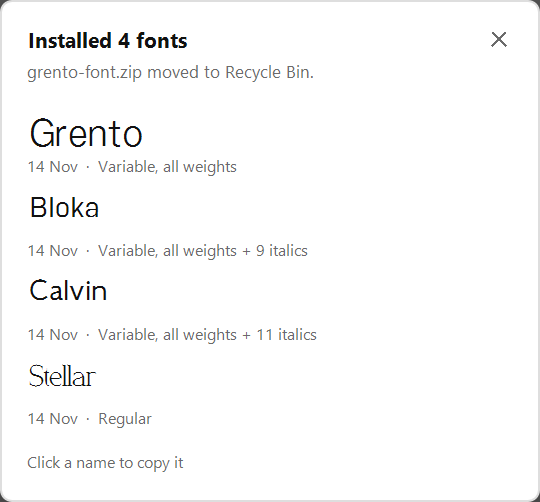

# Font Auto Installer

Download a font. It's installed. That's it.

A tiny Windows 11 tray app for designers. It watches your **Downloads** folder and installs every new font the moment the download finishes. ZIP, RAR, 7Z, folders or single files. It picks the best version of each font, skips what you already have and tidies the download into the Recycle Bin.

No setup, no account, no internet, no admin rights. One 35 KB exe.

**[Download the latest version](../../releases/latest)**

---

## Why

Font sites (Envato, Google Fonts, Creative Market, Dafont, foundries) give you a ZIP. Then you unzip it, dig through `OTF`, `TTF`, `Web`, `Variable` and `static` folders, select everything, right-click, install, click through "already installed" warnings and delete the ZIP. Every single time.

This app does all of that by itself in about 5 seconds.

## What it does

| You download | What happens |
|---|---|
| `Font.otf` or `Font.ttf` | Installed |
| `Font.zip` / `Font.rar` / `Font.7z` | Unpacked, best files installed |
| A folder of fonts | Best files installed |
| A ZIP inside a ZIP (inside a folder) | Unpacked up to 3 levels deep |
| A ZIP with no fonts in it | Ignored, left alone |
| Any other file | Ignored, left alone |

### It picks the right files

Font packs usually ship the same font several times. For every font family the app follows these rules:

1. **Variable wins.** If the pack has a variable version (detected from the font's own data, or `Variable` / `[wght]` in the file name), only the variable files are installed. One variable file covers every weight. Upright and italic are judged separately, so a pack with an upright-only variable file still gets its static italics.
2. **OTF over TTF.** If the same font comes as both OTF and TTF, the OTF is installed.
3. **No duplicates.** The same font sitting in two subfolders is installed once, even when the foundry named the OTF and TTF differently (`Bloka-BlackItalic` vs `Bloka Black Italic`).
4. **No overwrites.** A font that's already installed on your PC is skipped. Nothing that Illustrator, Figma or Word is using gets replaced.
5. **Junk skipped.** `__MACOSX` folders, `._` files and web fonts (`WOFF`, `WOFF2`, `EOT`) are ignored.

### It cleans up, carefully

After installing, the download goes to the **Recycle Bin** (never deleted for good, so you can restore it). This only happens when the download contained nothing but fonts plus harmless extras like licenses, readmes, PDFs and preview images.

If the download also holds anything else, like a `.psd`, `.ai`, mockup or template, the fonts are still installed but the download **stays in Downloads** untouched.

### It tells you what you got

Downloaded something random and forgot its name? A card pops up near the clock listing every font family that was installed, **each name drawn in its own typeface**.



- **Click a name to copy it**, then paste it into Illustrator, Figma or Word's font box.
- Fades out after 5 seconds. Hover to keep it open, or close it with ✕.
- **Never steals focus.** It floats on top but you keep typing, selecting or playing in your app, even if you click the popup.
- **Stays quiet during fullscreen games, videos, presentations and Do Not Disturb.** The fonts still install and show up in your history.
- Follows your Windows light or dark mode.

**Missed it?** Left-click the tray icon (or pick **Recently installed fonts** from its menu) to see your last 50 installed fonts, newest first, with the date and what was installed. Click any name to copy it.

### It's light on battery

- **No polling.** It doesn't check the folder every few seconds. Windows wakes it only when something lands in Downloads.
- **Efficiency mode.** Runs at idle priority with Windows 11 EcoQoS, the same mode Task Manager shows as a green leaf.
- About 35 to 50 MB RAM and ~0% CPU while waiting.

## Install

1. Download **`FontAutoInstaller.exe`** from the [latest release](../../releases/latest).
2. Move it to a folder you'll keep, for example `Documents\FontAutoInstaller\`. (Not Downloads, or it may watch itself.)
3. Double-click it. A blue **Aa** icon appears near the clock. Done.

It starts by itself every time you log in.

**"Windows protected your PC" warning?** The exe isn't code-signed (signing certificates cost money). Click **More info** then **Run anyway**. You can check the file first: the release notes list its SHA-256 hash, and the full source code is in this repo so you can build it yourself (see below).

**Can't see the icon?** Windows 11 hides new tray icons behind the **^** arrow next to the clock. Drag the Aa icon onto the taskbar to keep it visible. Double-clicking the exe again also shows a popup confirming it's running.

## Tray menu

Left-click the **Aa** icon to see recently installed fonts. Right-click it for the menu:

| Item | Does |
|---|---|
| Recently installed fonts | Your font history, click a name to copy it. |
| Pause watching | Stops installing until you resume. Icon turns grey. |
| Open log | Text file listing every font installed or skipped. |
| Open installed fonts folder | Where your fonts were copied. |
| Start with Windows | Untick to stop auto-start. |
| Quit | Closes the app. |

## Check a pack without installing

```
FontAutoInstaller.exe --scan "C:\path\to\SomeFont.zip"
```

Prints every font found, which ones would be installed and whether the download would go to the Recycle Bin.

## Privacy and security

Read the code. It's short. Here is exactly what the app can and can't do.

**It never connects to the internet.** There is no networking code at all. No updates, no analytics, no tracking, no accounts. It works fully offline.

**Folders it reads or writes:**

| Location | Why |
|---|---|
| `Downloads` (top level) | Watches for new downloads. Reads them. Moves fully installed font downloads to the Recycle Bin. |
| `%LOCALAPPDATA%\Microsoft\Windows\Fonts` | Where Windows keeps per-user fonts. Installed fonts are copied here. |
| The exe's folder (or `%LOCALAPPDATA%\FontAutoInstaller` if that's read-only) | `log.txt`, `history.txt` (names of fonts it installed) and a temporary `work` folder used while unzipping. Cleaned after each download. |

**Registry entries it writes (all under your user, `HKEY_CURRENT_USER`):**

| Key | Why |
|---|---|
| `Software\Microsoft\Windows NT\CurrentVersion\Fonts` | Registers each installed font, same as right-click > Install. |
| `Software\Microsoft\Windows\CurrentVersion\Run` → `FontAutoInstaller` | Auto-start at login. Removed when you untick "Start with Windows". |
| `Software\FontAutoInstaller` | Remembers if you turned auto-start off. |

**Safety measures:**

- Runs as you, never as admin. It can't touch system files.
- Unpacking uses `tar.exe`, which ships with Windows 11. It refuses archive paths that try to escape the unpack folder.
- Shortcuts, symlinks and junctions inside archives or in Downloads are never followed.
- Archives over 500 MB are skipped.
- Fonts are only copied, never modified.
- Nothing is permanently deleted. Downloads go to the Recycle Bin.

**One honest caveat:** installing a font means Windows reads it. A deliberately malicious font file could, in theory, target a bug in Windows' font engine. That risk is the same as installing it by hand, and Windows keeps it patched. Download fonts from sites you trust. You can always **Pause** the app from the tray.

## Uninstall

1. Right-click the **Aa** icon, untick **Start with Windows**, then **Quit**.
2. Delete `FontAutoInstaller.exe` and its `log.txt` and `history.txt`.

Fonts it installed stay installed. Remove them from **Settings > Personalization > Fonts** if you want.

## Build it yourself

No tools to install. It compiles with the C# compiler that's already inside Windows (.NET Framework 4.8).

```
git clone https://github.com/KumarAbhayRaj/font-auto-installer.git
cd font-auto-installer
powershell -ExecutionPolicy Bypass -File windows\build.ps1
```

Output: `windows\app\FontAutoInstaller.exe`.

## Code map

| File | Job |
|---|---|
| `windows/src/Program.cs` | Entry point, one-copy-only check, `--scan` mode, app folders. |
| `windows/src/TrayApp.cs` | Tray icon, menu, auto-start. |
| `windows/src/FontToast.cs` | The popup card: font names in their own typeface, click to copy, 5 s fade. |
| `windows/src/DownloadWatcher.cs` | Waits until a download is truly finished (no change for 3 s, file unlocked). Ignores `.crdownload` / `.part` temp files. |
| `windows/src/PackageScanner.cs` | Opens folders and archives, finds fonts, decides if the download is safe to recycle. |
| `windows/src/FontInfo.cs` | Reads font names straight from the file, spots variable fonts, applies the pick rules. |
| `windows/src/FontInstaller.cs` | Per-user install and duplicate check. |
| `windows/src/FontJob.cs` | One download from start to finish, popup rows, install history, dry run report. |
| `windows/src/NativeMethods.cs` | Windows calls (font refresh, Recycle Bin, Efficiency mode), safe file walking, log. |

## Mac version

In progress. Plan: [docs/MAC_PLAN.md](docs/MAC_PLAN.md). Code will live in `mac/`.

## Requirements

Windows 11 (or Windows 10 build 17063+ with `tar.exe`). .NET Framework 4.8 is built in.

## License

MIT. Free for everyone, personal or commercial.
